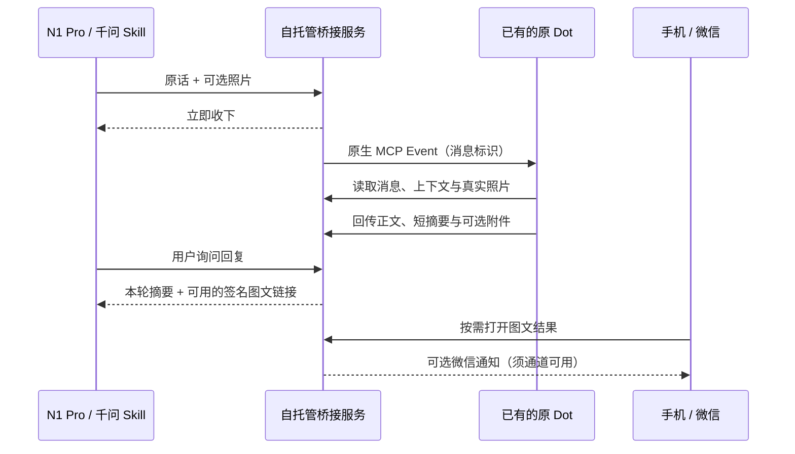

# Dots Glasses Bridge

测试首次会从 GitHub 官方固定版本下载一个公开 Hysteria 二进制，仅作哈希与文件校验夹具，不执行、不读取节点凭据；缓存于 Git 忽略的 .test-assets。下载必须通过固定 SHA-256，离线测试需预先准备缓存。普通服务启动不会下载它。

[English](README.en.md)

把千问 N1 Pro 眼镜接到你原来的 Dot：说一句话、拍一张照片，继续和同一个助手交流。眼镜先收下请求，原 Dot 通过原生 MCP Events 接收事件、读取原话和照片，再回传回复；眼镜负责简短转述，手机按需打开完整图文。

这是面向个人自托管的实验项目。**眼镜与原 Dot 的实机交流已由使用者确认；微信文字、照片和图文报告曾完成手机验收，但最近一次微信出站返回 `ret=-2`，目前仍按拒绝状态暂停。不能据此宣称当前整条链路已通过验收。** 验收范围见 [ACCEPTANCE](docs/ACCEPTANCE.md)。本项目与千问、OpenAI、微信均无官方隶属关系。



| 能力 | 当前范围 |
| --- | --- |
| 原 Dot | 连接已有助手，由其原有工具和授权规则处理；不启动 Hermes CLI，也不另建 API 模型助手 |
| 逐轮语音 | 支持追问、纠正、选项回答和有限对话上下文；用户明确要求时重新开始 |
| 照片 | 支持官方拍照结果、继续追问上一张照片、同段对话增加新照片 |
| 图文回复 | 眼镜读短摘要；有有效附件时提供外部 HTTPS 签名结果页，链接最多有效 15 分钟 |
| 主动通知 | 微信为独立可选出口；眼镜主动播报、实时语音打断、持续免唤醒拾音均未实现 |
| 原 Dot 输出同步 | 仅同步通过桥接工具提交或主动发布的内容；不能自动无损镜像全部原 Dot 输出 |

不需要在个人电脑上常驻浏览器页面。桥接服务及可选微信 worker 需要持续运行，可由你自己的进程管理器托管。原生 Events、后台订阅和账号权限的可用性取决于你实际使用的平台与账号，并非每个账号都保证具备。[千问平台](https://device.qianwen.com/) · [Dot 接入边界](docs/DOT.md)

## 开始使用

1. 准备可运行 Node.js 的主机、域名、HTTPS 反向代理，以及可连接原生 MCP Events 的原 Dot。运行时最低版本见 [package.json](package.json)；本项目测试使用 Node.js 24。
2. 在源码目录安装并验证：

   ```sh
   npm ci
   npm test
   npm run check
   ```

3. 生成全新安装的私有配置，再按 [部署说明](docs/DEPLOY.md) 配置 HTTPS、启动服务。下例安装目录是需要自行创建与授权的示例绝对路径：

   ```sh
   node deploy/init.mjs --install-dir /srv/dots-bridge --public-base-url https://dots.example.com/dots --port 17326
   DOT_EVENTS_CONFIG=/srv/dots-bridge/.dot-events/private/config.json node server.mjs
   ```

4. 分别完成 [千问眼镜配置](docs/QIANWEN.md) 和 [原 Dot 授权与订阅](docs/DOT.md)，按 [验收清单](docs/ACCEPTANCE.md) 验证。[微信接入](docs/WEIXIN.md) 是可选步骤，不是眼镜交流的前置条件。

当前公开入口是通用初始化器；没有提供 Windows 专用安装器。PowerShell 启动方式见 [DEPLOY](docs/DEPLOY.md)，微信登录和后台 worker 操作见 [WEIXIN](docs/WEIXIN.md)。初始化器生成新状态，不是既有私有安装的迁移工具。

## 安全与维护

私有配置、连接口令、OAuth 状态、微信登录信息、消息、照片和签名结果链接都不应提交到仓库。HTTP 服务只监听 `127.0.0.1`，默认端口 `17326`，通过你控制的 HTTPS 代理提供访问；不要直接公开本地端口。眼镜平台凭据、微信出站凭据、微信入站凭据须保持独立，原 Dot 通过 OAuth 授权。[认证参考](https://developers.openai.com/plugins/build/auth)

结果链接属于持有即可访问的临时入口；不要贴到公开日志或 issue。微信账号只允许一个消息消费者，避免多个 worker 争用游标。`accepted` 表示上游接口接受，不等于手机已经显示；`rejected` 或 `unknown` 不会静默重发。遇到 `ret=-2` 时保留回执，按 [故障排查](docs/TROUBLESHOOTING.md) 处理，不猜测为固定有效期过期或一律要求重新扫码。

实现说明见 [ARCHITECTURE](docs/ARCHITECTURE.md)，来源与参考见 [REFERENCES](docs/REFERENCES.md)。采用 [MIT License](LICENSE)。
