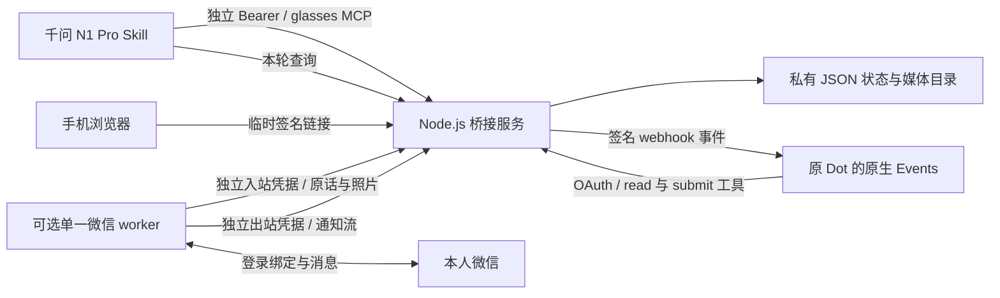

# 架构与数据流

本项目采用快速收下、异步处理的方式。千问只把用户的原话与真实照片送入桥接服务，不代替原 Dot 回答。原 Dot 收到原生事件后主动读取消息，再调用桥接工具回传结果。眼镜查询回复时取已保存的本轮结果，不让一次工具调用等待长任务结束。

## 连接与状态

公开基址固定为 `https://dots.example.com/dots` 形式。眼镜使用 `/dots/glasses/mcp`，原 Dot 使用 `/dots/mcp`，健康检查是 `/dots/health`。OAuth 元数据位于域名根下的 `/.well-known/oauth-authorization-server/dots` 和 `/.well-known/oauth-protected-resource/dots/mcp`，代理必须一并转发。当前 HTTP JSON-RPC 实现不提供常驻浏览器或持续 SSE 会话；MCP 的基础传输背景见 [官方传输规范](https://modelcontextprotocol.io/specification/2025-03-26/basic/transports)。

眼镜事件为 `glasses.message.created`，筛选参数为 `{"channel":"n1pro"}`；可选微信事件为 `bridge.message.created`，筛选参数为 `{"channel":"weixin"}`。事件只含消息关联信息；原话、上下文和照片通过授权工具读取。原生 Events 依赖目标 Dot 平台的实际实现，不是所有 MCP 客户端都具有的通用保证。

| 状态 | 能证明的事实 |
| --- | --- |
| `queued` | 桥接服务已保存消息 |
| `notified` | 事件入口接受了投递 |
| `processing` | 原 Dot 已读取消息 |
| `replied` 且非空回复 | 原 Dot 已回传这条消息的回复，仍不代表相关工作已完成 |
| 微信 `accepted` | 上游发送接口接受；实际手机显示仍需验收 |

消息、订阅、投递和回复持久化在独立私有目录。它是单进程个人桥接实现，不是多租户消息平台；不要让多个 server 同时写同一数据目录。`request_id`、`reply_id` 和微信通知编号承担幂等关联，同一编号必须对应同一内容。

当前存储有硬性容量上限：500 条消息、500 条通知、16 个订阅、500 个事件、8,000 条投递记录，状态文件上限 32 MiB，媒体目录上限 64 MiB。这些是保护性限制，不是无限保留承诺；媒体过期仅拒绝读取，磁盘照片不会自动删除，消息也不会自动归档。接近容量或收到拒绝时应先保护私有数据、评估保留与清理范围，不能直接删除目录来恢复业务。实现依据见 [store.mjs](../lib/store.mjs)。

## 对话与媒体

普通眼镜追问默认接续当前对话；显式 `conversation_id` 可指定对话，`new_conversation=true` 只在用户要求重新开始时使用。重开对话不会删除原 Dot 记忆或任务。桥接上下文上限为最近 8 轮、合计 24,000 字符，不能据此承诺无限历史。新照片、引用指定旧照片和复用上一张照片是互斥输入。

媒体支持 JPEG、PNG、WebP，以及输出 PDF、纯文本文件；单张图片上限 4 MiB，单个文件上限 8 MiB。一次回复最多 3 个附件、其中最多 1 张图片，附件总计不超过 8 MiB。媒体默认可用期为 24 小时；结果页和下载链接最多有效 15 分钟，并受实际附件剩余有效期约束。重新查询仅在附件仍有效时生成新链接。纯文字回复没有附件时不生成图文结果页。

下载器校验 HTTPS、目标地址、证书、格式、大小和重定向边界；不能把任意内网地址改成可用的媒体来源。结果页由服务端提供，是手机按需打开的外部页面，不是原生手机卡片，也不依赖个人电脑常驻页面。代码依据见 [media.mjs](../lib/media.mjs)、[presentation.mjs](../lib/presentation.mjs)。

## 微信后台

微信 worker 可以与服务同机，也可以通过 HTTPS 独立运行；不要求两台服务器。`watch` 仅转发通知，`watch-chat` 读取本人文字与照片并转发完整回复。每个账号只能有一个消息消费者，登录、手动上下文查询与 worker 操作也须协调。

完整回复按需拆分，先保存发送计划，再逐段发送，只有确认接受才前移游标。出站 `rejected` 或 `unknown` 会持久化为暂停，不自动换编号、重发或清空回执；双向 worker 在出站暂停时仍可继续接收本人消息。允许重试的是代码明确分类的读取/网络瞬时故障，不能据此重试已被拒绝的发送。[实现](../lib/weixin-duplex.mjs) · [排查与恢复边界](TROUBLESHOOTING.md)
